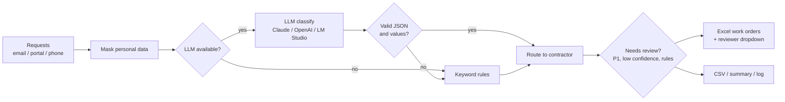

# Maintenance Request Triage with AI

A small Python tool that reads incoming maintenance requests for commercial buildings, uses an LLM to classify them, and produces a prioritised work-order list. A human reviewer checks the result before anything is dispatched.

It was built as a portfolio project for property management. The data is fictional.

**What it does with each request (Estonian, English or Russian):**

1. **Masks personal data.** E-mails, phone numbers and Estonian ID codes are removed before any text goes to the model.
2. **Classifies the request.** It finds the system (HVAC, electrical, plumbing, fire safety, elevator, doors/access, cleaning), the priority P1–P4, the location, and a one-line English summary for the technician.
3. **Validates the model output.** Unknown categories, broken JSON and out-of-range values are rejected. If that happens, a keyword rule engine takes over, so the run never stops.
4. **Routes the request** to the right contractor.
5. **Flags requests for human review.** These are all P1s, low-confidence answers and rule-engine results.
6. **Writes the results.** It produces an Excel work-order sheet with a reviewer dropdown, a CSV for import, a Markdown summary for the manager, and a log file.
7. **Scores itself** against hand-labelled data (`--eval`), so prompts and models can be compared.



## Run it

You need Python 3.10 or newer. The only extra library is `openpyxl`, which writes the Excel file.

```bash
pip install -r requirements.txt

python -m triage --eval                       # no API key needed: rule engine
python -m triage --provider lmstudio --eval   # local model in LM Studio (data stays on the PC)
python -m triage --provider anthropic --eval  # needs ANTHROPIC_API_KEY
python -m triage --provider openai --eval     # needs OPENAI_API_KEY
python -m pytest -q                           # 11 tests, including the LLM path with a fake model
```

Example output from the rule engine is in `examples/`. A run writes its results to `output/`: `work_orders.xlsx`, `work_orders.csv`, `summary.md` and `run.log`.

Settings are environment variables:

| Variable | Default | Meaning |
|---|---|---|
| `TRIAGE_PROVIDER` | `rules` | `anthropic`, `openai`, `lmstudio` or `rules` |
| `TRIAGE_MODEL` | provider default | model name |
| `LMSTUDIO_URL` | `http://localhost:1234/v1` | local OpenAI-compatible server |
| `TRIAGE_REVIEW_BELOW` | `0.75` | confidence below this goes to review |

## Design decisions

- **Human in the loop.** The tool suggests and a person decides. Every P1 is confirmed by phone, and anything uncertain is reviewed before a work order goes out.
- **Fail safe, not fail silent.** Network errors and bad answers are retried, then logged, then handled by the rule engine. A request is never dropped.
- **Privacy first.** Personal data is masked before the LLM call, in line with the GDPR data-minimisation principle. LM Studio mode keeps all data on the machine.
- **Measured, not assumed.** `--eval` reports category and priority accuracy, and also *P1 requests missed*. A missed emergency costs far more than a false alarm.
- **No heavy framework.** The HTTP calls use only the Python standard library, so the tool is easy to run on a locked-down office PC.

## Results on the sample data

| Engine | Category | Priority | P1 missed | Sent to review |
|---|---|---|---|---|
| Keyword rules only | 95% | 95% | 0 of 7 | 20 of 20 |
| Qwen2.5 3B Instruct (local, CPU), first version | 75% | 60% | **2 of 7** | 9 of 20 |
| Same model + keyword safety net (current version) | 75% | 65% | **0 of 7** | 12 of 20 |

The rules were written while looking at these 20 requests, so their number is optimistic: new wording will break them.

### What the test run showed

The first run used a small local model (Qwen2.5 3B Instruct, Q4_K_M, about 9 s per request on CPU). It showed four problems:

1. **It missed emergencies.** A burning smell near the electrical room and half a warehouse without power were rated P2 instead of P1.
2. **It invented details.** "Bins not emptied" became "air conditioning unit emitting smoke", and a broken card reader became "people trapped". This is why the Excel sheet shows the original request next to the AI summary.
3. **Its self-reported confidence was useless.** It gave 0.90–1.00 on almost every answer, including the wrong ones, so confidence alone cannot decide what gets reviewed.
4. **It returned an invented category** ("LIGHTING"). Validation rejected it, and the rules took over as designed.

**The fix was to run the keyword rules next to the model as a safety net.** If either engine sees an emergency, the request becomes P1 and goes to a person. The same applies when the two engines disagree on the category. This removed both missed emergencies at the cost of a few more reviews. In this domain that is the right trade-off: a false alarm costs a phone call, while a missed fire risk costs far more.

A larger model (Claude, GPT-4o class) is expected to do much better. The same `--eval` run makes that comparison measurable, not a guess.

## How it maps to a Microsoft 365 setup

| Here | In production |
|---|---|
| `data/requests.jsonl` | Shared mailbox or tenant portal; Power Automate trigger "When a new email arrives" |
| `triage` package | Azure Function or Power Automate HTTP action calling the same prompt and validation |
| `work_orders.xlsx` + reviewer column | SharePoint list with an approval flow |
| `summary.md` | Daily Teams message to the property manager |
| `run.log` | Application Insights / flow run history |

## Project structure

```
triage/
  schema.py     categories, priorities, routing, output validation
  privacy.py    masking of e-mails, phones, ID codes
  llm.py        Anthropic / OpenAI / LM Studio client with retries
  rules.py      multilingual keyword fallback
  pipeline.py   mask -> classify -> validate -> route -> review flags
  report.py     Excel, CSV, Markdown output
  evaluate.py   accuracy against labels
data/           20 fictional requests + labels
tests/          pytest suite
```

Author: Petr Zherebtsov. The building maintenance background comes from my *Kinnisvarahooldaja, tase 4* qualification and 10+ years of industrial maintenance work.
